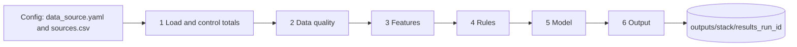
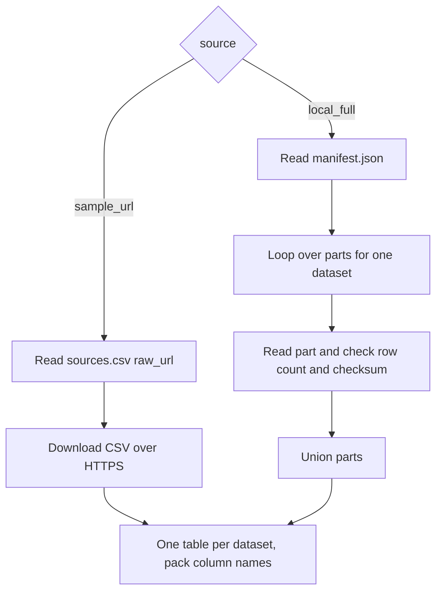

# Alteryx and KNIME design

Design only. No Alteryx workflow (.yxmd) or KNIME workflow (.knwf) has been built or run. Every container, metanode, tool, node and macro named below is UNTESTED DESIGN until it is built and run in those tools. Runtime and memory will be measured, not guessed. A Klaus Konsults project.

## Purpose

Alteryx and KNIME run the same six stages and the same 22 numbered steps as the Python pipeline (docs/pipeline_steps.md), on the same input files, and write the same shared results file (docs/output_schema.md). That is what lets the three tools be compared on the same records. Banking and telecom run as two separate passes and are never joined.

## Overall flow

The flow runs once with domain set to banking and once with domain set to telecom.

## Inputs

| Mode | Setting | Where it reads |
|---|---|---|
| Sample (default) | source = sample_url in config/data_source.yaml | raw GitHub URLs listed in config/sources.csv, for example https://raw.githubusercontent.com/Kuame-Klaus/fraud-detection-banking-telecom-/main/data/sample/banking/B1_transactions.csv |
| Local full | source = local_full | numbered parts under data/full/ in a local clone, listed in data/full/manifest.json with row count and checksum per part |

data/full/ and manifest.json are planned and not yet in the repo. The design assumes each manifest entry holds dataset_id, part file name, row count and SHA 256 checksum. If the final manifest uses other field names, the reader macro and component change to match.

## Outputs

Each tool writes outputs/alteryx/results_<run_id>.csv or outputs/knime/results_<run_id>.csv (Parquet option where supported), in the long format of docs/output_schema.md, with stack set to alteryx or knime. Column names, order and types follow that schema exactly. record_id must be the same id Python uses, so step 20 can compare tools row by row.

## Alteryx design

Each stage is one Tool Container, named "1 Load and control totals" to "6 Output", so a stage can be switched off for testing.

### Macros

| Macro | Type | Job |
|---|---|---|
| KK_ReadDataset.yxmc | Batch macro | one batch per manifest part: Input or Download, check row count and checksum, output union of parts. In sample mode one batch per raw URL |
| KK_ControlTotals.yxmc | Standard macro | row count and amount total per month for one dataset, plus the B7 and T1 versions |
| KK_DQChecks.yxmc | Standard macro | steps 5 to 12 for one dataset, output rows in dq format |
| KK_Rule_<scenario>.yxmc | Standard macro, one per scenario | one scenario rule, outputs score rows with rule_id |
| KK_ToResults.yxmc | Standard macro | maps any stage output to the shared schema columns |

For the wildcard case, the Input Data tool can also read data/full/<dataset>/part_*.csv.gz in one pass. The batch macro is preferred because it checks each part against the manifest.

### Tools per container

| Container | Tools |
|---|---|
| 1 Load and control totals | Text Input or Input Data (config), Filter on source, Download, Text To Columns or CSV parse, JSON Parse (manifest), KK_ReadDataset batch macro, Select (types), Formula (SHA 256 chain of custody log), KK_ControlTotals, Join to client or generator totals |
| 2 Data quality | KK_DQChecks, Summarize (null rates, debit equals credit per entry), Unique (key checks), Join (orphan checks), Generate Rows plus Join (missing days), Formula (future timestamps, currency, negatives), Union into dq rows |
| 3 Features | Formula, Multi Row Formula, Summarize, Join, Running Total, DateTime tools, all within one domain |
| 4 Rules | one KK_Rule macro per scenario for the domain, Union, Formula for rule_id and scenario |
| 5 Model | Create Samples or Formula for the fixed time split, Boosted Model or Forest Model (built in learners), Score, Formula for predicted_label at the threshold, Summarize for metrics |
| 6 Output | Formula for threshold changes at minus 20, minus 10, plus 10 and plus 20 percent, Summarize for coverage and drift, Join to Python results for agreement, Summarize for edges, Benford and geo, KK_ToResults, Union, Output Data |

Run with the AMP engine, raise sort and join memory, and give temp files ample disk space for 20 million rows.

## KNIME design

Each stage is one metanode, named "1 Load and control totals" to "6 Output". Reusable parts are shared components.

### Components

| Component | Job |
|---|---|
| KK Read Dataset | loop over parts: JSON Reader for the manifest, Table Row To Variable Loop Start, CSV Reader or Parquet Reader with the path from a flow variable, row count and checksum check, Loop End to concatenate. In sample mode CSV Reader with the raw URL |
| KK Control Totals | row count and amount per month, plus the B7 and T1 versions |
| KK DQ Checks | steps 5 to 12 for one dataset, output in dq format |
| KK Rule <scenario> | one per scenario, outputs score rows with rule_id |
| KK To Results | maps a stage output to the shared schema |

### Nodes per metanode

| Metanode | Nodes |
|---|---|
| 1 Load and control totals | Configuration nodes or Table Creator (config), Rule Engine Variable on source, KK Read Dataset, Column Rename and String To Number (types), Java or Python Script snippet for SHA 256, KK Control Totals, Joiner to expected totals |
| 2 Data quality | KK DQ Checks, GroupBy (null rates, debit and credit sums), Duplicate Row Filter (keys), Joiner with left outer (orphans), Create Date and Time Range plus Joiner (missing days), Rule Engine (future timestamps, currency, negatives), Concatenate |
| 3 Features | Math Formula, Lag Column, Moving Aggregation, GroupBy, Joiner, Date and Time Difference, all within one domain |
| 4 Rules | one KK Rule component per scenario, Concatenate, Constant Value Column for rule_id and scenario |
| 5 Model | Row Filter for the fixed time split, Gradient Boosted Trees Learner and Predictor (or Random Forest), Rule Engine for predicted_label, Scorer and Binary Classification Inspector or GroupBy for metrics |
| 6 Output | Math Formula for threshold changes, GroupBy for coverage, drift, edges, Benford and geo, Joiner to Python results for agreement, KK To Results, Concatenate, CSV Writer or Parquet Writer |

Raise -Xmx in knime.ini, use the columnar table backend, and stream or chunk where the nodes allow it.

## One to one match with Python

| Stage | Steps | Python module | Alteryx container | KNIME metanode |
|---|---|---|---|---|
| 1 Load and control totals | 1 to 4 | python/pipeline/load.py (discover, read, control_totals) | 1 Load and control totals with KK_ReadDataset and KK_ControlTotals | 1 Load and control totals with KK Read Dataset and KK Control Totals |
| 2 Data quality | 5 to 12 | python/pipeline/dq.py (checks) | 2 Data quality with KK_DQChecks | 2 Data quality with KK DQ Checks |
| 3 Features | 13 | python/pipeline/features.py (banking_features, telecom_features) | 3 Features | 3 Features |
| 4 Rules | 14 | python/pipeline/rules.py (one function per scenario) | 4 Rules with KK_Rule macros | 4 Rules with KK Rule components |
| 5 Model | 15 to 16 | python/pipeline/model.py (split, fit_score, metrics), XGBoost | 5 Model, Boosted Model | 5 Model, Gradient Boosted Trees |
| 6 Output | 17 to 22 | python/pipeline/output.py (write_results), run.py for runtime and memory | 6 Output with KK_ToResults | 6 Output with KK To Results |

The model differs by design: XGBoost in Python, built in learners in Alteryx and KNIME. Inputs, splits, rules and the output schema are meant to be identical, so differences in results point to the learner or to a build fault.

## Checks before a build is accepted

1. Control totals per dataset match Python's dq rows for the same input.
2. Rule alerts per scenario match Python's for the same record_id on the sample.
3. The results file passes a column and type check against docs/output_schema.md.
4. Runtime and peak memory are written as run rows.

## Open design points

1. Final manifest.json field names and the data/full/ folder layout.
2. Whether the agreement step reads the other tools' results from GitHub or from a local folder.
3. How KNIME and Alteryx report peak memory, which may need an outside measure.
