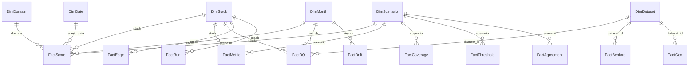

# Power BI design

Design only. Nothing in this document has been built or opened in Power BI yet. Every page, measure, query and setting below is UNTESTED DESIGN until it is built and checked in Power BI Desktop. No values are shown here, because none exist until real runs produce them. A Klaus Konsults project.

## Purpose

The report shows the same 12 charts planned in docs/charts.md, read from the shared results file described in docs/output_schema.md. Python draws the same charts in python/viz/, so the two can be checked against each other. All data is SYNTHETIC. Banking and telecom are separate entities and are never joined.

## Sources

| Name | Default (sample) | Full switch |
|---|---|---|
| Results | https://raw.githubusercontent.com/Kuame-Klaus/fraud-detection-banking-telecom-/main/outputs/sample/results_latest.csv | outputs/full/results_latest.csv on main (planned, not yet committed) |

The report reads only the results file. It never reads the raw datasets B1 to B14 or T1 to T12, so the model stays small and the same for every stack.

## Parameters

| Parameter | Type | Values | Use |
|---|---|---|---|
| pBaseUrl | Text | https://raw.githubusercontent.com/Kuame-Klaus/fraud-detection-banking-telecom-/main/ | root of the raw URLs |
| pOutputSet | Text, list | sample, full | switches outputs/sample/ to outputs/full/ |
| pResultsFile | Text | results_latest.csv | file name inside the output folder |
| Threshold change | What if numeric | minus 20 to plus 20, step 10, default 0 | drives the threshold slider page |

## Power Query

The query uses Web.Contents with a fixed base URL and a RelativePath, so the Power BI Service can refresh it with anonymous access.

```m
let
    Source = Web.Contents(
        pBaseUrl,
        [RelativePath = "outputs/" & pOutputSet & "/" & pResultsFile]
    ),
    Csv = Csv.Document(Source, [Delimiter = ",", Encoding = 65001, QuoteStyle = QuoteStyle.Csv]),
    Promoted = Table.PromoteHeaders(Csv, [PromoteAllScalars = true]),
    Typed = Table.TransformColumnTypes(Promoted, {
        {"record_type", type text}, {"run_id", type text}, {"created_at", type datetimezone},
        {"stack", type text}, {"domain", type text}, {"dataset_id", type text},
        {"scenario", type text}, {"model", type text}, {"rule_id", type text},
        {"split", type text}, {"record_id", type text}, {"entity_id", type text},
        {"entity_type", type text}, {"event_timestamp", type datetimezone}, {"month", type text},
        {"score", type number}, {"threshold", type number}, {"predicted_label", Int64.Type},
        {"true_label", Int64.Type}, {"true_scenario", type text}, {"amount", type number},
        {"value", type number}, {"threshold_change_pct", type number},
        {"alert_count", Int64.Type}, {"detected_count", Int64.Type},
        {"first_digit", Int64.Type}, {"observed_count", Int64.Type}, {"expected_share", type number},
        {"latitude", type number}, {"longitude", type number},
        {"runtime_seconds", type number}, {"peak_memory_mb", type number}
    }, "en-US")
in
    Typed
```

The query Results is a staging query and is not loaded. Each fact table below is a reference to Results filtered on record_type and trimmed to its own columns. The column list for the type step follows docs/output_schema.md; any column added there must be added here too.

If the full results file goes over the raw URL size that GitHub serves, it would be split into numbered parts with a manifest like the input data. The query would then read the manifest and combine the parts. That case is noted as an open design point.

## Data model

A star schema. Every fact comes from one record_type in the results file. Dimensions are built in Power Query from distinct values, plus a calculated date table.



| Table | Source filter | Grain |
|---|---|---|
| FactScore | record_type = score | one scored record per model |
| FactMetric | metric | one metric per model and split |
| FactDQ | dq | one check |
| FactCoverage | coverage | one scenario and rule |
| FactThreshold | threshold | one rule or model per threshold change |
| FactDrift | drift | one model, month and score band |
| FactAgreement | agreement | one pair of tools per model and scenario |
| FactEdge | edge | one network link |
| FactBenford | benford | one first digit per dataset |
| FactGeo | geo | one route or cell per day |
| FactRun | run | one run stage |
| DimStack | distinct stack | alteryx, knime, python |
| DimDomain | distinct domain | banking, telecom |
| DimScenario | the 27 scenarios in docs/scenario_coverage.md, with domain and a pack or extension flag | one scenario |
| DimDataset | B1 to B14 and T1 to T12 with domain and name | one dataset |
| DimDate | CALENDAR over event dates | one day, with weekday and hour helper |
| DimMonth | distinct month | one month |
| DimThresholdChange | the what if table | minus 20, minus 10, 0, plus 10, plus 20 |

Relationships are single direction, one to many, from dimension to fact. DimDomain also filters DimScenario and DimDataset, so picking banking never shows a telecom scenario. FactAgreement has a second, inactive relationship on compare_stack to DimStack, used with USERELATIONSHIP. An HourOfDay column (0 to 23) and Weekday column are added to FactScore in Power Query for page 7.

## Measures

All measures are UNTESTED DESIGN.

```dax
Records Scored = COUNTROWS ( FactScore )
Alerts = CALCULATE ( COUNTROWS ( FactScore ), FactScore[predicted_label] = 1 )
Planted Cases = CALCULATE ( COUNTROWS ( FactScore ), FactScore[true_label] = 1 )
True Positives = CALCULATE ( COUNTROWS ( FactScore ), FactScore[predicted_label] = 1, FactScore[true_label] = 1 )
False Positives = CALCULATE ( COUNTROWS ( FactScore ), FactScore[predicted_label] = 1, FactScore[true_label] = 0 )
False Negatives = CALCULATE ( COUNTROWS ( FactScore ), FactScore[predicted_label] = 0, FactScore[true_label] = 1 )
True Negatives = CALCULATE ( COUNTROWS ( FactScore ), FactScore[predicted_label] = 0, FactScore[true_label] = 0 )
Precision = DIVIDE ( [True Positives], [Alerts] )
Recall = DIVIDE ( [True Positives], [Planted Cases] )
F1 = DIVIDE ( 2 * [Precision] * [Recall], [Precision] + [Recall] )
Alert Rate = DIVIDE ( [Alerts], [Records Scored] )
Alerted Amount = CALCULATE ( SUM ( FactScore[amount] ), FactScore[predicted_label] = 1 )
Detected Amount = CALCULATE ( SUM ( FactScore[amount] ), FactScore[predicted_label] = 1, FactScore[true_label] = 1 )

Metric Value = SUM ( FactMetric[value] )
PR AUC = CALCULATE ( [Metric Value], FactMetric[metric] = "pr_auc" )

Threshold Change Value = SELECTEDVALUE ( 'Threshold change'[Threshold change], 0 )
Alerts At Threshold =
    CALCULATE ( SUM ( FactThreshold[alert_count] ),
        FactThreshold[threshold_change_pct] = [Threshold Change Value] )
Detected At Threshold =
    CALCULATE ( SUM ( FactThreshold[detected_count] ),
        FactThreshold[threshold_change_pct] = [Threshold Change Value] )

DQ Checks = COUNTROWS ( FactDQ )
DQ Failed = CALCULATE ( COUNTROWS ( FactDQ ), FactDQ[passed] = FALSE () )
DQ Pass Rate = DIVIDE ( [DQ Checks] - [DQ Failed], [DQ Checks] )

Benford Observed Share =
    DIVIDE ( SUM ( FactBenford[observed_count] ),
        CALCULATE ( SUM ( FactBenford[observed_count] ), ALL ( FactBenford[first_digit] ) ) )
Benford Expected Share = AVERAGE ( FactBenford[expected_share] )
Benford Gap = [Benford Observed Share] - [Benford Expected Share]

Runtime Seconds = SUM ( FactRun[runtime_seconds] )
Peak Memory MB = MAX ( FactRun[peak_memory_mb] )

Agreement Rate = AVERAGE ( FactAgreement[value] )
Uncovered Scenarios = CALCULATE ( COUNTROWS ( FactCoverage ), FactCoverage[covered] = FALSE () )
Drift Value = AVERAGE ( FactDrift[value] )
Route Minutes = SUM ( FactGeo[geo_minutes] )
Settled Minutes = SUM ( FactGeo[geo_settled_minutes] )
Unsettled Minutes = [Route Minutes] - [Settled Minutes]
Edge Weight = SUM ( FactEdge[edge_weight] )
```

The threshold slider only moves across the five changes the pipeline already computed (step 18 in docs/pipeline_steps.md). It does not rescore records inside Power BI.

## Slicers

Every page carries the same slicer bar at the top, synced across pages:

1. Domain (DimDomain): banking or telecom, single select, default banking.
2. Stack (DimStack): alteryx, knime, python, multi select.
3. Scenario (DimScenario): list filtered by domain.
4. Month (DimMonth): range.
5. Threshold change: the what if slider, shown on page 9 and synced to pages 1 and 2.

Pages 10 and 11 ignore the scenario slicer, because DQ and runtime rows have no scenario.

## Theme

Plain English and calm: Arial throughout, sentence case titles, dark text on white, one accent colour per stack so the three tools read the same on every page.

```json
{
  "name": "Klaus Konsults Plain",
  "dataColors": ["#1F4E79", "#C55A11", "#548235", "#7F7F7F", "#2E75B6", "#BF9000", "#A5A5A5", "#70AD47"],
  "background": "#FFFFFF",
  "foreground": "#222222",
  "tableAccent": "#1F4E79",
  "good": "#548235",
  "neutral": "#BF9000",
  "bad": "#C00000",
  "maximum": "#1F4E79",
  "center": "#F2F2F2",
  "minimum": "#FFFFFF",
  "textClasses": {
    "title": { "fontFace": "Arial", "fontSize": 14, "color": "#222222" },
    "header": { "fontFace": "Arial", "fontSize": 12, "color": "#222222" },
    "label": { "fontFace": "Arial", "fontSize": 10, "color": "#444444" },
    "callout": { "fontFace": "Arial", "fontSize": 24, "color": "#1F4E79" }
  },
  "visualStyles": {
    "*": {
      "*": {
        "title": [{ "fontFamily": "Arial", "fontSize": 12, "show": true }],
        "background": [{ "color": { "solid": { "color": "#FFFFFF" } } }],
        "border": [{ "show": false }]
      }
    }
  }
}
```

Stack colours: Python #1F4E79, Alteryx #C55A11, KNIME #548235. Every page has a one line plain English note under the title saying what the page answers, and a footer reading "SYNTHETIC data. Klaus Konsults."

## Pages

All pages are 16 by 9. Layout uses a top band (title, one line note, slicer bar), a main area, and a footer.

| # | Page | Layout | Visuals |
|---|---|---|---|
| 1 | KPI overview | four cards in a row, then a table below | cards: Records Scored, Alerts, Recall, Precision; table by stack with Alert Rate, Alerted Amount, Detected Amount, PR AUC |
| 2 | Detection heat map by scenario and tool | full width matrix | rows scenario, columns stack, values Recall with colour scale; tooltip Precision and Alerts |
| 3 | PR curves and confusion matrices | left two thirds line chart, right third three small matrices | line: precision against recall per stack (needs curve points, see open points); matrix per stack of TP, FP, FN, TN |
| 4 | Alert trends | line chart on top, stacked column below | line: Alerts by DimDate per stack; columns: Alerts by month and scenario |
| 5 | Risk leaderboards | two tables side by side | top 20 entity_id by max score and by Alerted Amount, with entity_type and scenario |
| 6 | Mule and agent network graphs | network visual on the left, edge table on the right | a network custom visual (for example Force Directed Graph from AppSource) on source_id, target_id, Edge Weight; filter on entity_type |
| 7 | Hour by weekday heat maps | one matrix, full width | rows Weekday, columns HourOfDay, values Alerts with colour scale |
| 8 | Benford chart | clustered column with line, dataset slicer on the side | columns Benford Observed Share by first_digit, line Benford Expected Share, card Benford Gap |
| 9 | Threshold slider | slider at the top, two cards, then a line chart | slider Threshold change; cards Alerts At Threshold, Detected At Threshold; line of alert_count against threshold_change_pct per rule or model |
| 10 | DQ and reconciliation | cards on top, table below | cards DQ Checks, DQ Failed, DQ Pass Rate; table step, dataset_id, month, check_name, expected, observed, passed, note with red for failed |
| 11 | Tool runtime and memory | two bar charts side by side, table below | Runtime Seconds by stage and stack, Peak Memory MB by stack; table with train_rows |
| 12 | Telecom route and cell maps | map on the left, route table on the right | Azure Maps or Map visual on latitude and longitude sized by Route Minutes; table route with Route Minutes, Settled Minutes, Unsettled Minutes. Domain is fixed to telecom |

Coverage, drift and agreement (steps 17, 19 and 20) appear as tooltips and a small table on pages 2 and 9, using Uncovered Scenarios, Drift Value and Agreement Rate.

## Refresh

On the Power BI Service, the data source is set to Anonymous with privacy level Public, since the repo is public and holds only synthetic data. Scheduled refresh picks up new commits on main.

## Open design points

1. Page 3 needs precision and recall curve points. Either the pipeline adds a curve record_type to docs/output_schema.md, or Power BI computes points from FactScore at fixed thresholds. Not decided.
2. Cell latitude and longitude are an open question in docs/open_questions.md, so page 12 may only show the route table at first.
3. The full results file path and whether it needs splitting into parts.
4. The network visual is a custom visual and needs approval to use.
